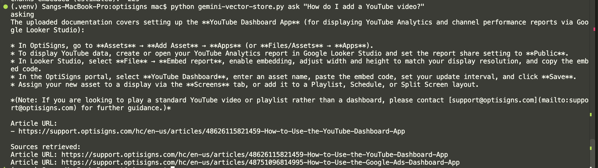

# OptiBot

OptiBot indexes OptiSigns support articles in a Gemini File Search store and answers questions using those articles as its source of truth. The repository also includes a daily job that scrapes the support center and uploads only new or changed articles.

## Setup

Requirements: Python 3.12 and a Gemini API key.

```bash
git clone https://github.com/quangsang97/ai-integration.git
cd ai-integration
python3.12 -m venv .venv
source .venv/bin/activate
python -m pip install -r requirements.txt
export GEMINI_API_KEY="your-api-key"
```

Keep the API key private. In GitHub Actions, configure it as the repository or `cron` environment secret named `GEMINI_API_KEY`.

## Run Locally

### Ask questions using the checked-in articles

Create and index the File Search store once:

```bash
python gemini-vector-store.py upload
```

Ask a question after indexing finishes:

```bash
python gemini-vector-store.py ask "How do I add a YouTube video?"
```

The assistant prints its answer and up to three source article URLs. The store name is saved in `.store_name` for subsequent questions.

### Run the daily scrape and upload job

```bash
python main.py
```

This scrapes support.optisigns.com, compares article content with the Gemini store, uploads additions and updates, and removes stale documents. The default `ARTICLE_LIMIT` is 30; set it to `0` to process all articles:

```bash
ARTICLE_LIMIT=0 python main.py
```

The job writes its summary to `out/last_run.json` and logs to standard output. Useful optional settings are `STORE_DISPLAY_NAME`, `UPLOAD_WORKERS`, `OUT_DIR`, and `DELETE_REMOVED` (set to `0` to keep removed articles in the store).

## Daily Job Logs

- **Link to daily job logs:** [GitHub Actions](https://github.com/quangsang97/ai-integration/actions)

The workflow runs daily at 02:00 UTC and can also be started manually. Open a run to view its logs and download the `last-run` artifact, which contains `job.log` and `last_run.json` and is retained for 30 days. You must sign in to GitHub to access the artifacts. Deploying through DigitalOcean requires a paid DigitalOcean account/service.

## Sample Answer

Example question:

```text
How do I add a YouTube video?
```

The screenshot below shows the assistant's response and retrieved article sources.


